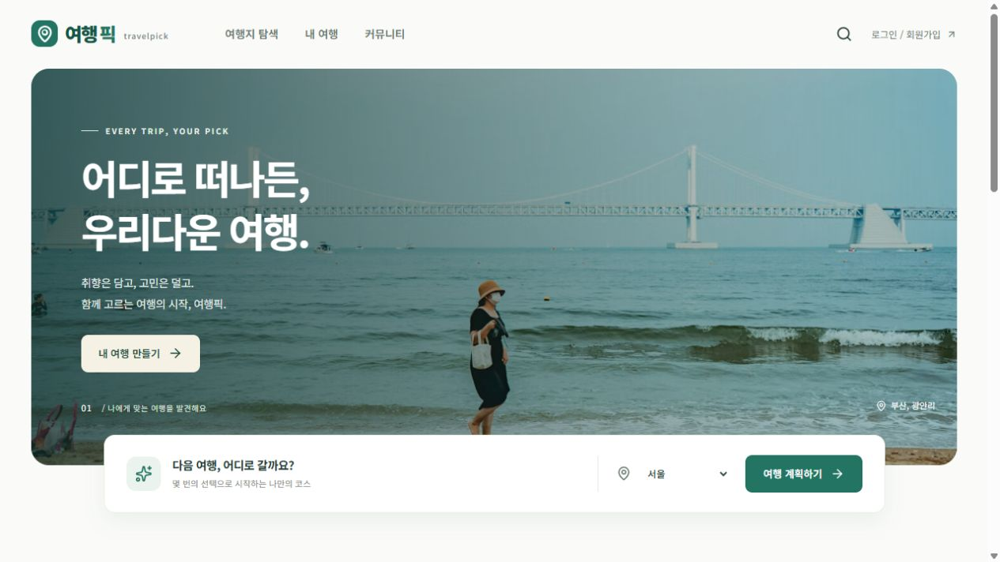

# 여행픽 · Every trip, your pick

취향을 담은 세 가지 국내 여행 코스를 비교하고, 동행과 함께 다듬는 모바일 반응형 여행 플래너입니다.

**현재 버전은 로컬에서 실제 가입·저장·공동 수정·대화를 사용할 수 있는 첫 개발 버전입니다.** 장소/AI 키가 없으면 서울·부산·제주·강릉의 명시적인 예시 데이터와 규칙 추천으로 동작합니다. 실제 좌석·객실 재고, 결제, 소셜 로그인까지 완성된 운영 서비스로 표시하지 않습니다. 구현과 후속 작업은 [기능 상태표](docs/status.md)에 구분했습니다.



## 실행

- Java 21 이상, Node.js 22.12 이상 또는 24 권장
- Maven은 별도 설치할 필요 없이 `backend/mvnw.cmd`로 내려받습니다.
- 기본 포트: 웹 `5173`, API `18081`. 기존 프로젝트의 8080/8081을 사용하지 않습니다.

Windows PowerShell에서:

```powershell
cd C:\SudalSudal\project\tripPlanner
.\scripts\Start-Dev.ps1
```

[http://127.0.0.1:5173](http://127.0.0.1:5173)에서 회원가입하면 됩니다. 배포 가능한 공용 데모 계정은 만들지 않았습니다. 로컬 DB는 `backend/.data/travel.mv.db`에 유지되고 Git에 포함되지 않습니다. 로그는 `.tools/`에 남습니다.

```powershell
.\scripts\Stop-Dev.ps1
```

직접 실행할 때는 터미널 두 개를 사용합니다.

```powershell
# 터미널 1
cd backend
.\mvnw.cmd spring-boot:run

# 터미널 2
cd frontend
npm ci
npm run dev
```

`Start-Dev.ps1`은 이미 사용 중인 포트를 발견하면 종료하며 다른 프로그램을 강제로 끄지 않습니다. 실행 JAR을 사용 중일 때 Windows에서는 재패키징이 제한되므로 백엔드를 종료하고 빌드하세요.

## 직접 체험할 흐름

1. 가입 → 마이페이지에서 기본 취향과 메시지 수신 범위를 저장합니다.
2. 내 여행 만들기 → 지역·기간·인원·예산·이동 방식·숙소 후보·이번 여행 취향을 선택합니다.
3. 세 가지 코스를 비교하고 저장합니다. 활동비, 숙소 예시 비용, 제외된 비용을 구분해 확인합니다.
4. 다른 후보 비교 → 비용·이동 시간·이후 방문 시간의 변화를 미리 보고 적용합니다.
5. 예약 탭에서 직접 확인한 성공/실패/취소를 기록합니다. 확정된 장소는 고정되어 자동 교체되지 않습니다.
6. 다른 계정을 만들고 이메일로 초대합니다. 초대를 수락해야 공동 편집과 단체 대화가 가능해집니다.
7. 읽기 전용 링크를 공유합니다. 공개 화면에는 출발지, 숙소, 예약 메모, 개인 대화, 지출이 제외됩니다.
8. 커뮤니티에서 후기·추천·코스·동행 모집을 작성하고 메시지 요청을 주고받습니다. 요청 수락과 사용자 차단을 확인합니다.

## 두 가지 차별화 기능

**바꾸기 전에 전체 영향 비교**: 한 장소를 교체할 때 전체 인원의 활동비 변화, 이동 시간 변화, 이후 일정 시간을 함께 보여줍니다. 뒤에 고정된 예약에 늦거나 하루가 너무 길어지면 적용을 거절합니다. 변경 이력에서 방문 일정을 복원할 수 있습니다.

**예약과 동행을 고려하는 공동 계획**: 초대를 수락한 회원만 접근하며 개인의 기본 취향을 여행의 취향에 합칩니다. 저장마다 버전을 확인해 다른 사람의 수정을 덮어쓰지 않습니다. 직접 확인한 예약을 제휴 자동 확인과 구분하고 고정 장소를 보호합니다.

## 구조와 기술

```text
frontend/
  src/app/              # 라우터, 내비게이션, 공통 디자인 토큰
  src/features/         # home, auth, catalog, planner, trips, community, messaging, profile, admin
  src/shared/           # HTTP·CSRF, 타입 계약, 세션/토스트, 공통 상태·모달
backend/
  src/main/java/kr/yeohaengpick/
    auth/               # BCrypt, 세션, 이메일 토큰, 인증 요청 제한
    catalog/            # Kakao 장소 어댑터와 명시적인 로컬 예시
    integration/        # Gemini 후보 평가 및 제한/장애 대체
    trip/               # 일정 엔진, 전체 영향 비교, 예약, 이력, 공유
    collaboration/      # 초대 수락과 여행 취향 합치기
    messaging/          # 요청함, 개인/단체 대화, 수신 범위, 상호 차단
    community/          # 게시물, 댓글, 동행 모집, 신고, 관리자 감사 기록
    common/             # 오류 응답, JSON, MyBatis Map 변환
  src/main/resources/db/migration/  # Flyway 스키마 버전 관리
  src/test/             # 실제 HTTP 통합 테스트와 일정 엔진 테스트
docs/                   # 기획, 아키텍처, API, 진행 상태, 검증 기록
scripts/                # Windows 개발 서버 시작/종료
.github/workflows/      # Java 21 + Node 24 빌드/테스트
```

| 기술 | 선택 이유 |
| --- | --- |
| Java 21 · Maven · MyBatis | 기존에 익숙한 Java/SQL 흐름을 유지하고 SQL과 권한 범위를 명확히 확인 |
| Spring Boot 4.1 · Security | 세션·CSRF·트랜잭션·검증을 공통 계층으로 처리 |
| React 19 · Vite 8 · TypeScript | 빠른 개발 환경과 화면/서버 계약의 타입 검사 |
| TanStack Query | 서버 조회 캐시, 로딩·실패, 일정/메시지의 주기적 동기화 |
| PostgreSQL · Flyway | 운영 관계형 DB와 스키마 이력. 로컬은 설치 부담을 줄인 H2 |
| Gemini REST 어댑터 | 조회된 장소 후보의 취향 평가. 서버 엔진이 실제 일정 제약을 검증 |

자세한 판단과 제약은 [아키텍처](docs/architecture.md), [API 안내](docs/api.md)를 참고하세요. 중요한 책임·보안 경계·알고리즘 이유는 코드에 한국어 주석으로 적었습니다.

## 외부 서비스 설정

`.env.example`을 `.env`로 복사하고 로컬에서 값을 입력합니다. **키를 채팅이나 Git에 올리지 마세요.** 시작 스크립트가 `.env`를 읽습니다. 직접 Maven으로 실행한다면 같은 값을 터미널 환경변수에 설정해야 합니다.

- `KAKAO_REST_KEY`: 서버 장소 검색. 이름·좌표·상세 링크를 가져옵니다. API가 제공하지 않는 리뷰 본문·영업시간·입장료를 만들지 않습니다.
- `KAKAO_JS_KEY`: 지도 SDK용 공개 키. 카카오 플랫폼에 사용하는 웹 도메인을 등록하세요. REST 키와 분리합니다.
- `GEMINI_API_KEY`: 서버 후보 평가. 키 미설정/한도/응답 오류 시 화면에 규칙 추천임을 표시합니다. 기본 호출 제한은 **서버 프로세스당 하루 20회**이며 공급자의 무료 할당량과 동일하지 않습니다.
- `MAIL_ENABLED=true` + SMTP + `MAIL_FROM`: 이메일 인증과 재설정. 관리자 이메일은 인증을 완료하고 재로그인해야 권한이 적용됩니다.

Gmail을 발송 계정으로 사용할 때는 [로컬 연결 안내](docs/gmail-setup.md)를 참고하세요. 이메일 주소와 SMTP 인증 정보는 `.env`에만 보관합니다.

지도와 AI 키 발급·도메인 등록·무료 등급 확인은 [Kakao·Gemini 연결 안내](docs/maps-ai-setup.md)를 참고하세요. 기본 AI 모델은 `gemini-3.5-flash-lite`이며 프로젝트의 모델 접근·무료 할당량을 확인한 뒤 실제 호출을 검증합니다.

무료 할당량과 이용 조건은 계정·앱·시점에 따라 달라집니다. 무료 사용을 보장하는 값으로 하드코딩하지 않았습니다. [Kakao Local](https://developers.kakao.com/docs/ko/local/dev-guide), [Gemini 모델](https://ai.google.dev/gemini-api/docs/models), [구조화 출력](https://ai.google.dev/gemini-api/docs/structured-output)을 확인하세요.

## 검증

```powershell
cd backend
.\mvnw.cmd test
cd ..\frontend
npm test
npm run build
npm run format:check
```

서버 테스트는 별도의 H2 메모리 DB와 임의 포트로 실행합니다. 로컬 여행 DB를 변경하지 않고 외부 AI·메일·예약 서비스를 호출하지 않습니다. [검증 기록](docs/verification.md)에 테스트 범위와 실제 브라우저 확인 내용을 적습니다.

## 운영 전 남은 작업

현재 구현은 운영 출시 완료가 아닙니다. 실제 교통 경로/시간표/요금, 숙소 재고와 제휴 예약 콜백, Kakao·Gemini 실제 계정 검증, 실제 비밀번호 재설정 메일 흐름, 소셜 로그인, 전국 데이터 확장, 권한 회수/회원 탈퇴, 개인정보 처리방침, 백업·모니터링·분산 요청 제한이 후속 작업입니다. Gmail 발송·수신·이메일 인증은 로컬에서 확인했습니다. 운영 DB에서는 `prod` 프로필과 PostgreSQL, HTTPS 및 동일 출처 프록시를 사용해야 합니다. 자세한 순서는 [기능 상태표](docs/status.md)에 남겼습니다.

사진 출처는 [에셋 기록](docs/assets.md)을 참고하세요. 저장소는 포트폴리오 공개 전까지 비공개로 관리합니다.
