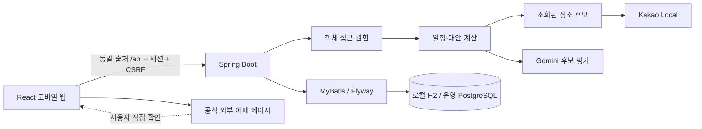

# 구조와 주요 결정

## 모듈 경계

프론트는 기능별 디렉터리와 공통 API/타입/상태를 분리합니다. 서버는 인증·장소·일정·협업·메시지·커뮤니티로 나눕니다. 외부 장소 검색과 AI 호출은 일정 엔진 바깥에 있어 공급자를 교체할 수 있습니다. UI는 서버가 계산한 비교 결과를 표시하며 브라우저가 보낸 가격·좌표를 그대로 저장하지 않습니다.

## AI의 역할

AI에는 후보 ID·분류·지역과 여행 취향을 보냅니다. 메일·사용자 이름·채팅·예약 번호·출발지 주소를 전송하지 않습니다. JSON 배열 스키마와 후보 ID 화이트리스트로 결과를 제한합니다. 서버가 날짜·지역 배분·장소 중복·일정 길이·추정 비용을 계산합니다. 응답 지연/잘못된 결과/키 미설정/프로세스 한도 초과는 규칙 추천으로 전환하고 `engine` 값에 사유를 남깁니다.

현재 최적화는 휴리스틱입니다. 실제 대중교통 시간표나 전역 최적해를 보장하지 않습니다. AI가 휴무·가격·재고를 생성하지 않습니다.

## 변경과 동시 편집

`preview`는 쓰기 없이 장소를 바꾼 결과와 이후 시간을 계산합니다. `apply`는 동일 버전과 권한을 다시 확인하고 `UPDATE trips ... WHERE version=?`가 한 행을 변경한 경우에만 일정과 이력을 같은 트랜잭션에서 저장합니다. 충돌은 409로 반환합니다. 고정 예약은 교체할 수 없고 이후 고정 시간에 도착하지 못하는 변경을 거절합니다.

이력은 방문 일정 스냅샷입니다. 복원은 현재 고정 예약을 바꾸는 경우 거절합니다. 숙소·교통 예약 기록, 초대, 경비는 방문 일정 복원에 포함하지 않습니다. 현재는 폴링이며 실시간 WebSocket 기반 편집은 후속 개선입니다.

## 인증과 데이터 노출

- BCrypt 12, 비밀번호 길이와 UTF-8 72바이트 제한
- HttpOnly 세션, SameSite=Lax, prod Secure, 상태 변경 CSRF
- 로그인 시 세션 ID 변경. 재설정 후 credential_version 변경으로 기존 세션 전부 거절
- 이메일 인증/재설정은 SHA-256 해시·30분 만료·원자적 한 번 사용
- 관리자 역할은 서버 설정 이메일의 소유권 인증 후 부여. UI role 입력을 받지 않음
- DB 조회마다 여행/대화 참여 확인. 새 개인 대화는 수신 범위·상호 차단·요청 수락 검사
- 공개 일정은 공개 가능한 필드만 새 객체에 복사. 내부 객체에서 일부 필드만 빼는 방식으로 확장하지 않음
- 신고된 대화 메시지 한 건만 관리자 신고 화면에서 확인. 전체 개인 대화 열람 API 없음
- 인증/AI 제한은 단일 서버 메모리. 분산 운영 전 Redis 등의 공유 저장소 필요

## 금액과 데이터 출처

장소 비용은 개인당 추정 활동비, 숙소는 1객실 1박 예시입니다. 숙박과 왕복/지역 간 교통은 활동비 합계에 포함되지 않습니다. Kakao Local은 객실 가격·입장료를 제공하지 않으므로 0으로 보관된 미확인 값은 화면에 확인 필요로 표시해야 하며 무료로 해석하면 안 됩니다. 이 구분을 장기적으로 nullable 금액과 `priceStatus` 모델로 확장할 예정입니다.

로컬 장소는 `SAMPLE`, 외부 검색은 `KAKAO`로 보존합니다. API 리뷰 본문을 복제하지 않고 상세 지도 페이지로 연결합니다. 현재 행선지 선택 UI는 4개 지역이며 전국/다른 카테고리는 데이터 확장 단계입니다.

## 운영 구성

프론트 정적 파일과 `/api`를 같은 HTTPS 출처로 서비스합니다. Vite 개발 서버는 운영 서버로 쓰지 않습니다. `SPRING_PROFILES_ACTIVE=prod`, PostgreSQL JDBC 환경변수, `PUBLIC_URL`을 설정합니다. 운영자는 비밀 키, TLS, 프록시/요청 제한, 세션 저장, 백업, 모니터링, 개인정보 정책을 구성해야 합니다. 실제 운영 배포나 PostgreSQL 연결은 아직 검증하지 않았습니다.
