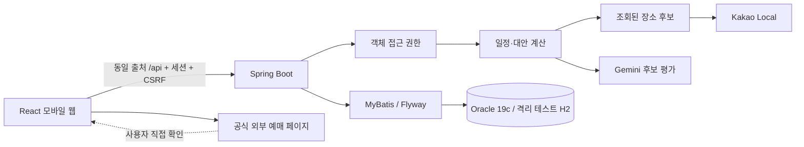

# 구조와 주요 결정

## 공개 일정 가져오기

`TripSharingService`는 공개 화이트리스트와 SHA-256 스냅샷, `TripImportMapper`는 회원별 요청 완료 기록을 관리합니다. 원본 잠금과 토큰 재검사 후 공개 필드만 새 항목으로 저장하고 비공개 조건/예약/멤버십은 넘기지 않습니다. V14는 복사본 삭제의 NULL FK와 재시도 키를 보존하며 회원 탈퇴 때 정리합니다. `SharedTripImport`는 내 조건 입력과 응답 유실 재시도, 최신 공개 일정 검토를 담당합니다. [권한·중복·보존과 한계](shared-trip-import.md)

## 커뮤니티 전체 검색

커뮤니티 공개 목록은 `CommunitySearchService`와 `CommunitySearchMapper/Sql`로 검색·건수·페이지를 분리합니다. SQL 조건을 재사용하고 공개 필드만 제한 조회하며, 화면은 URL 조건과 상세 복귀 주소를 함께 관리합니다. 기존 DB 구조와 한국어 코멘트를 유지합니다. [검색 계약과 동시 변경·성능 한계](community-search.md)

## Oracle 저장소

실제 DB는 Oracle 19c 전용 스키마를 사용합니다. `oracle` 프로필은 전용 Flyway 위치와 JDBC 연결을 선택하고, MyBatis는 명시적인 Oracle BOOLEAN SQL 및 Map의 열 이름/숫자/CLOB/날짜 변환으로 기존 API 계약을 유지합니다. 자동 테스트의 기본 H2 이력은 그대로 보존합니다. 실제 전체 HTTP 시나리오는 별도 Oracle QA 스키마에서도 실행하며 이전은 앱 시작과 분리한 도구에서 FK 순서·단일 커밋·전체 값 해시 검증을 거칩니다. [접속·이전·복구 상세](oracle-setup.md)

## 신고 당시 내용과 DB 설명

`ReportService`가 대상별 최소 필드만 보존하고 `ReportMapper`가 신고 행 잠금/최초 처리와 감사를 관리합니다. 글은 기존 게시글 잠금과 순서를 맞추고 메시지는 현재 대화 권한을 확인합니다. `ReportCard`는 증거와 조치 입력을 구분합니다. V12/V13의 `COMMENT ON TABLE/COLUMN`을 Oracle·공통 이력에 함께 넣고 실제 DB 사전의 누락 여부를 자동 검사합니다. [개인정보 범위와 한계](report-evidence.md)

## 여행 소유권 이전

`TripOwnershipService`는 여행 행을 잠근 뒤 현재 소유자·대상 참여·요청 버전을 검사해 소유권/버전 변경, 대기 초대 종료, 변경 기록을 한 트랜잭션에 저장합니다. V10의 별도 기록은 방문 일정 복원과 분리하며 공개 공유에서 제외합니다. 기존 소유자는 동행으로 남습니다. `TripOwnershipPanel`이 대상 선택·권한 확인·충돌 안내·최근 기록을 담당합니다. [권한 변화와 보존 계약](trip-ownership.md)

## 커뮤니티 글 관리

`CommunityCommentService`는 부모 게시글 잠금 → 댓글 소속/작성자/독립 버전 검사 → 조건부 수정/삭제를 담당합니다. V9는 댓글 수정/삭제 시각과 버전을 추가합니다. 삭제 행은 내부에 남기고 공개 쿼리에서 전부 제외하며 부모 글 복원으로 되살리지 않습니다. 화면의 `PostComments`는 목록과 별도 관리창 상태를 유지해 폴링에서 댓글이 삭제되어도 초안 복사 안내를 제공합니다.

`CommunityPostService`가 작성자 권한·공개 여부·버전·게시글 행 잠금을 한 트랜잭션에서 관리합니다. V8의 `deleted_at`은 작성자 휴지통, 기존 `hidden`은 운영진 숨김이며 복원으로 숨김을 해제하지 않습니다. 댓글/신고 참조를 보존하고 동행 모집 복원은 마감 상태로 제한합니다. 화면은 목록·상세·공통 작성/수정 양식·휴지통으로 나누어 지연 로드합니다. [관리 계약과 화면 동기화](community-management.md)

## 동행 참여와 권한 회수

`TripMembershipService`는 현재 참여·소유권·여행 버전을 확인한 뒤 참여 행과 이전 초대 상태만 변경합니다. 여행의 쓰기 트랜잭션은 `TripService.access`에서 동일한 여행 행을 잠가 참여 종료와 편집/단체 메시지 전송을 순서대로 처리합니다. 단체 대화 목록도 현재 참여자 기준이며 방의 과거 생성자로 접근을 허용하지 않습니다. 열린 화면의 권한 종료는 기존 폴링으로 감지합니다. [권한·기록 보존·동시 요청 상세](trip-membership.md)

## 방문 조건과 일정 엔진

V7의 조건은 추천 원가와 분리한 사용자 입력값입니다. `VisitConditions`가 검증·유효 비용·범위 충돌을 담당하고, `WholeSchedule`은 방문별 시작 하한/종료 상한을 배치에 적용합니다. 다른 시간 변경 엔진은 공통 `BookingSchedule.inspect`를 거쳐 범위 위반 안의 적용을 막습니다. 조건 저장은 방문 시각을 바꾸지 않고 버전만 조건부 증가시켜 공동 편집과 열린 비교를 보호합니다. 같은 장소의 이력 복원은 최신 조건을 유지하며 장소 교체는 조건을 초기화합니다. [입력·복원 상세](visit-conditions.md)

## 모듈 경계

프론트는 기능별 디렉터리와 공통 API/타입/상태를 분리합니다. 서버는 인증·장소·일정·협업·메시지·커뮤니티로 나눕니다. 외부 장소 검색과 AI 호출은 일정 엔진 바깥에 있어 공급자를 교체할 수 있습니다. UI는 서버가 계산한 비교 결과를 표시하며 브라우저가 보낸 가격·좌표를 그대로 저장하지 않습니다.

### 프론트 라우트 로딩 경계

홈·로그인·계정 복구와 공통 내비게이션은 첫 HTML 뒤에 바로 사용할 수 있게 초기 묶음에 둡니다. 탐색·계획·여행·공유·메시지·마이페이지·관리자·찜 기능은 경로별 `React.lazy` 청크로 분리해 사용자가 열지 않은 기능의 코드를 모바일 첫 다운로드에 포함하지 않습니다. 보호 경로는 `RequireAuth`가 지연 화면을 감싸 인증을 먼저 확인하고, 로그인하지 않은 사용자의 `next` 복귀 주소를 보존합니다.

`AsyncRoute`는 공통 내비게이션을 유지하면서 본문에 경로별 로딩 문구를 보여 주고, 청크 다운로드나 화면 표시 실패는 원인을 단정하지 않는 설명과 새로고침 버튼으로 복구합니다. `scripts/check-bundle-budget.mjs`는 빌드된 첫 HTML의 실행·미리 로드 JavaScript를 raw와 gzip으로 합산하고 전체 파일도 확인합니다. `npm run build`는 초기 340kB/raw·112kB/gzip, 전체 청크 500kB/raw, 개별 지연 청크 180kB/raw를 넘으면 실패하며, 새 기능은 예산을 올리기 전에 기존 경계를 조정합니다.

## AI의 역할

AI에는 공개 장소의 ID·이름·분류·지역·좌표와 여행 취향을 보냅니다. 메일·사용자 이름·채팅·예약 번호·출발지 주소를 전송하지 않습니다. 여러 지역은 전송 한도를 나누어 앞 지역만 평가하는 일을 막습니다. JSON 배열 스키마와 후보 ID 화이트리스트로 결과를 제한합니다. 서버가 날짜·지역 배분·장소 중복·일정 길이·추정 비용을 계산합니다. 응답 지연/잘못된 결과/키 미설정/프로세스 한도 초과는 규칙 추천으로 전환하고 `engine` 값에 사유를 남깁니다.

현재 최적화는 휴리스틱입니다. 실제 대중교통 시간표나 전역 최적해를 보장하지 않습니다. AI가 휴무·가격·재고를 생성하지 않습니다.

장소 선택 단계에서 기존 후보/선택 숙소와의 평균 직선 거리를 이동 수단별 가중치로 반영한 뒤 가까운 순서와 식사 시간대를 조합합니다. 코스 중복을 피하려고 대안을 고를 때도 거리 증가를 고려합니다. 하루 종료 시간 때문에 제외한 후보는 다음 방문의 시간 계산에 포함하지 않습니다. 병원·주차장 등 일반 업종과 실제 주소가 요청 지역 밖인 검색 결과는 제외하고, 컨벤션센터를 전시로 일괄 분류하지 않습니다. 분류·실내 추정은 실제 행사/영업 정보를 대체하지 않습니다.

## 실제 경로 어댑터

`transport` 패키지의 컨트롤러 → 권한/저장 장소 해석 서비스 → 공급자 응답 변환기로 책임을 나눕니다. 기존 Kakao REST 키로 카카오맵 대중교통·도보와 카카오모빌리티 자동차 API를 호출합니다. 사용자가 버튼을 누르면 선택한 구간만 조회하며 모든 추천 후보 쌍을 자동 호출하지 않습니다. 기기 위치 권한을 요청하지 않고 출발지를 직접 검색하게 합니다. 검색어는 Kakao Local, 경로 좌표는 해당 경로 공급자에 전달되고 Gemini에는 보내지 않습니다. 전송 원문을 로그/DB/공유 일정에 추가 저장하지 않습니다.

실제 조회값은 추천 엔진의 추정 시각과 별도입니다. 조회 경로는 실선, 전체 방문 순서는 점선으로 지도에 구분합니다. 요금 미제공과 통행료 0원을 구분하고, 조회 시각·출처·운행/좌석 미확인 안내를 함께 표시합니다. 경로 선택은 지도 표시만 바꾸므로 동행의 일정과 고정 예약을 변경하지 않습니다. 날짜/버전/조건 변경 시 이전 경로를 초기화합니다.

## 변경과 동시 편집

`TransportQuotes`는 공급자 조회 결과를 회원·여행 버전에 묶어 15분 동안 보관합니다. `RouteTimingService`는 이 영수증과 현재 연속 구간을 검증하고 DB 없는 `RouteSchedule` 엔진에 넘깁니다. 엔진은 출발 유지/도착 유지 두 안을 계산하고 고정 방문·교통 예약 및 이미 적용한 다른 구간도 확인합니다. 클라이언트에서 전달한 분이나 변경 시각을 신뢰하지 않습니다.

날짜 간 이동은 전날 마지막→다음 날 첫 방문만 연결합니다. `LocalDateTime`으로 실제 이동 구간을 비교해 밤의 대기·숙박을 소요 시간으로 계산하지 않습니다. 방문 날짜를 유지하는 두 안은 별도 계산하며 기존 같은 날/숙소 계산을 재사용합니다. V5 JSON의 `originDeparture`에 날짜 간 한국 현지 출발 일시를 저장하므로 기존 기록과 스키마는 유지됩니다. 실제 이동 구간은 새 예약·장소 변경·방문 복원에서도 현재 날짜를 기준으로 검사합니다.

화면의 `transportSchedule`은 예약 장소 검색 준비와 조회 후 시간상 여유를 계산하는 순수 함수입니다. 장소명으로 좌표를 확정하지 않고 회원별 검색 토큰을 선택하게 합니다. 예약 연결의 여유 표시는 읽기 전용이며 저장 권한·충돌 검증은 기존 서버 계약이 계속 담당합니다. 검색/경로 조회는 버튼을 눌렀을 때만 호출합니다.

적용은 기존 조건부 version 증가와 같은 트랜잭션에서 방문·이력·V5 구간 기록을 저장합니다. 구간 기록은 여행+도착 항목 키의 서버 생성 JSON이고, 조회 시각·출처·선택 수단·추가 여유·숙소 출발을 보존합니다. 일정 항목을 교체 삽입하는 구조 때문에 항목 FK를 사용하지 않고 장소 ID·좌표·연속 순서로 유효성을 검증해 무효 기록을 정리합니다. 적용한 값은 장소 비교·교통 예약 조정·복원에도 사용하고, 전체 후보 쌍의 경로를 추가 조회하지 않습니다.

`BookingSchedule`은 DB·외부 API에 의존하지 않는 시간 제약 엔진입니다. 직접 확인 완료이고 사용자가 연결한 교통편만 출발 전 여유부터 도착 후 여유까지 방문 불가 구간으로 취급합니다. 시각은 KST의 `LocalDateTime`, 비교는 반열린 구간이므로 정확히 경계에서 끝나는 방문은 허용합니다. 자정 이동도 날짜를 포함해 비교합니다. V4는 기존 기록을 연결하지 않은 상태로 확장해 과거의 불완전한 입력을 보호합니다.

충돌 보고서는 상세 API에서 참여자에게만 제공합니다. 방문 시간을 한 방향으로 조정하는 두 안은 장소·순서·방문일·체류·비용을 유지하고 고정 방문을 옮기지 않습니다. 여유 시간은 사용자 입력이며 방문 사이 이동은 적용한 조회 구간 시간을 우선하고 나머지는 기존 추정 엔진을 사용합니다. 모든 구간의 실제 경로를 자동 호출하는 최적화는 아직 수행하지 않습니다. 비교는 읽기 전용이고 적용은 클라이언트가 보낸 시각 대신 서버 재계산 결과를 저장합니다. 교통편 자체의 예약 시간은 조정안 적용이나 방문 이력 복원으로 변경되지 않습니다.

`preview`는 쓰기 없이 장소를 바꾼 결과와 이후 시간을 계산합니다. `apply`는 동일 버전과 권한을 다시 확인하고 `UPDATE trips ... WHERE version=?`가 한 행을 변경한 경우에만 일정과 이력을 같은 트랜잭션에서 저장합니다. 충돌은 409로 반환합니다. 고정 예약은 교체할 수 없고 이후 고정 시간에 도착하지 못하는 변경을 거절합니다.

이력은 방문 일정 스냅샷입니다. 복원은 현재 고정 예약을 바꾸거나 현재 교통 예약의 이동·여유 시간과 겹치면 거절합니다. 숙소·교통 예약 기록, 적용한 조회 경로 시간, 초대, 경비는 방문 일정 복원에 포함하지 않습니다. 복원할 방문 시간이 현재 조회 구간을 침범하면 거절하며, 사용자가 일정 탭에서 조회값 반영을 해제할 수 있습니다. 현재는 폴링이며 실시간 WebSocket 기반 편집은 후속 개선입니다.

## 인증과 데이터 노출

- BCrypt 12, 비밀번호 길이와 UTF-8 72바이트 제한
- HttpOnly 세션, SameSite=Lax, prod Secure, 상태 변경 CSRF
- 로그인 시 세션 ID 변경. 재설정 후 credential_version 변경으로 기존 세션 전부 거절
- 이메일 인증/재설정은 SHA-256 해시·30분 만료·원자적 한 번 사용
- 관리자 역할은 서버 설정 이메일의 소유권 인증 후 부여. UI role 입력을 받지 않음
- DB 조회마다 여행/대화 참여 확인. 새 개인 대화는 수신 범위·상호 차단·요청 수락 검사
- 공개 일정은 공개 가능한 필드만 새 객체에 복사. 내부 객체에서 일부 필드만 빼는 방식으로 확장하지 않음
- 신고된 대화 메시지 한 건만 관리자 신고 화면에서 확인. 전체 개인 대화 열람 API 없음
- 인증/AI 제한은 단일 서버 메모리. 분산 운영 전 Redis 등의 공유 저장소 필요
- 회원 탈퇴는 `WithdrawalService/Mapper`가 소유 여행 선처리·공개 원문 제거·계정 비식별화·참여/토큰 종료를 한 트랜잭션으로 수행한다. `AccountLifecycle`의 공유 요청/배타 탈퇴 경계는 단일 JVM용이며 다중 서버 전 분산 잠금으로 교체해야 한다. [삭제·보존과 동시성 한계](account-withdrawal.md)

## 금액과 데이터 출처

장소 비용은 개인당 추정 활동비, 숙소는 1객실 1박 예시입니다. 숙박과 왕복/지역 간 교통은 활동비 합계에 포함되지 않습니다. Kakao Local은 객실 가격·입장료를 제공하지 않으므로 0으로 보관된 미확인 값은 화면에 확인 필요로 표시해야 하며 무료로 해석하면 안 됩니다. 이 구분을 장기적으로 nullable 금액과 `priceStatus` 모델로 확장할 예정입니다.

로컬 장소는 `SAMPLE`, 외부 검색은 `KAKAO`로 보존합니다. API 리뷰 본문을 복제하지 않고 상세 지도 페이지로 연결합니다. 현재 행선지 선택 UI는 4개 지역이며 전국/다른 카테고리는 데이터 확장 단계입니다.

## 숙소 경유와 최소 체류

숙소 경유는 `OvernightService`가 같은 숙소를 연결하는 두 서버 영수증과 최신 여행을 검증하고 `OvernightSchedule`이 체류/출발 조건을 기존 날짜 간 시간 엔진에 결합합니다. 프론트의 `OvernightPanel`은 명시적 경로 조회, `OvernightModal`은 조건·비교·적용을 담당합니다. 비교에 필요한 전체 시간에는 숙소 체류·대기를 넣지만 저장한 이동 합계에서는 제외합니다. 저장 기록은 V5 경로 JSON의 선택 `overnight` 필드로 확장해 이전 기록과 호환하며, 기존 예약 충돌·복원·공유 제외·버전 검사와 해제 경로를 재사용합니다. 이 기능은 한 날짜 경계의 시간 연결이며 객실 예약이나 전체 여행 최적화는 아닙니다.

## 직접 확인한 숙박 조건

숙박 조건은 V6의 숙소별 선택 컬럼으로 보관합니다. `LodgingStay`가 날짜·정수 입력과 경로의 체류 범위를 검증하며 비교·적용·이후 조건 편집에서 같은 규칙을 사용합니다. 프론트 `LodgingStayModal`은 열린 시점 여행과 version을 보존해 15초 자동 갱신이 오래된 입력을 최신 편집으로 덮어쓰지 않게 합니다. `lodgingBudget`은 직접 입력한 전체 합계, 예시 계산과 미확인 숙소를 구분하고 일정 상세와 장소 대안 비교가 같은 합계를 사용합니다. 예약/결제 상태와 경비 기록은 별도로 유지합니다.

## 저장 후 숙소 선택

`LodgingChoiceController/Service`는 참여 권한과 여행의 숙박 지역을 확인한 뒤 기존 Catalog의 숙소 분류 검색을 재사용합니다. 숙박일의 마지막 방문 지역에 머문다는 비교 가정 아래 해당 방문→숙소와 숙소→다음 날 첫 방문을 동일한 거리 기반 방식으로 계산합니다. 이전 숙소가 없으면 이전 이동 합계/차이는 null이며 0분 절약으로 표시하지 않습니다. 후보 전체의 실제 경로를 자동 호출하지 않아 추가 경로 쿼터를 사용하지 않습니다.

미리보기는 읽기 전용입니다. 적용 요청에서 검색 조건·후보 ID·version·예약 완료 보호를 다시 검사하고 `TripService.applyLodging`이 조건부 버전 증가·이력·지역별 숙소 교체·관련 경로 해제를 한 트랜잭션으로 처리합니다. 방문·고정·교통 예약·다른 지역 숙소·무관한 조회 기록은 유지합니다. 이전 숙소의 직접 입력 조건과 금액을 새 숙소에 복사하지 않고 예약 전으로 시작합니다. V2/V5/V6의 기존 구조를 사용하므로 새 마이그레이션은 없습니다. 이력 복원은 방문 일정만 대상으로 하며 옛 숙소나 해제한 영수증을 부활시키지 않습니다.

프론트 `LodgingPanel`이 비교를 열 때 여행을 보존하고 `LodgingChoiceModal`이 후보 검색·선택·영향·적용을 담당합니다. 입력 중인 검색어와 검색 완료 조건을 구분하고 검색어가 바뀌면 기존 안의 적용을 막습니다. `lodgingChoiceBudget`은 교체 지역만 바꿔 기존 공통 예산 함수를 사용하며 미확인 비용을 숫자 절약으로 비교하지 않습니다. 숙박일 가정과 실제 이용 조건의 차이, 경로 해제 수, 외부 예약 처리 필요를 적용 전에 표시합니다.

## 전체 방문 시각 비교 엔진

`WholeSchedule`은 기존 방문의 불변 복사본에 대해 앞→뒤 최소 시작, 뒤→앞 최대 시작을 계산한다. 하루 범위·고정 방문·같은 날 이동 간격과 교통 예약 구간을 제약으로 사용한다. 방문+직후 이동/여유 블록을 예약과 대조해 추정 이동도 탑승 예약을 가로지르지 않게 한다. 이미 적용한 이동 분·여유는 비교 입력으로 덮어쓰지 않고 날짜 간/숙소 출발·체류 앵커는 고정한다. 마지막에 전체 순서 간격, 예약, RouteTiming, LodgingStay를 재검증한다. 하루 요약은 방문 순서가 잘못된 원본도 정확히 보여주도록 최소 시작·최대 종료로 계산한다.

`TripService.wholeScheduleApply`는 미리보기와 같은 계산을 반복하고 조건부 version 증가·이력·방문 교체를 한 트랜잭션으로 실행한다. 클라이언트의 items 배열은 계약에 없고 사용하지 않는다. 장소·순서가 같으므로 기존 경로 JSON과 숙소/예약/지출은 보존된다. `WholeSchedulePanel`은 열릴 때의 여행 스냅샷을 사용하고 입력 변경 후 재비교 전에는 적용을 막는다. V6 스키마와 기존 이력 복원을 재사용한다. 전역 경로 최적화나 외부 API 일괄 조회를 수행하지 않는다.

## 관광공사 공개 이용 안내

`TourApiClient`는 고정된 HTTPS 공급자 주소·서버 키·시간 제한·캐시·단일 프로세스 호출 예산과 동시 요청 수를 관리한다. 인증키를 URI 변수로 한 번 인코딩하고 공급자 예외의 원문/URL을 노출하지 않는다. HTTP 200의 게이트웨이 오류, XML 장애, 잘못된 envelope/count와 정상 빈/마지막 페이지를 구분한다.

`TourismService`는 최신 법정동 코드 검색, 실제 주소 필터, contentId/type 재대조와 상세의 가장 오래된 조회 시각을 담당한다. `TourismInfo`는 유형별 원문 필드를 표시용 텍스트로 정리하고 HTML을 실행하지 않는다. 미제공 상태를 구조화하며 빈 값에서 무료/영업 가능을 생성하지 않는다. `TourismInfoButton`은 탐색·일정에서 공유하는 모달이며 결과를 사용자가 직접 선택한 후 상세로 이동한다. 기존 Place/방문/예산/예약 DB에는 쓰지 않으며 마이그레이션을 추가하지 않는다. 설정/제한은 [연결 안내](tourism-setup.md)에 기록한다.

## 운영 구성

프론트 정적 파일과 `/api`를 같은 HTTPS 출처로 서비스합니다. Vite 개발 서버는 운영 서버로 쓰지 않습니다. `SPRING_PROFILES_ACTIVE=prod,oracle`, Oracle JDBC 환경변수, `PUBLIC_URL`을 설정합니다. 운영자는 비밀 키, TLS, 프록시/요청 제한, 세션 저장, 백업, 모니터링, 개인정보 정책을 구성해야 합니다. 로컬 Oracle 연결·이전·HTTP 검증은 수행했으며 공개 운영 배포·다중 서버는 아직 검증하지 않았습니다.

## 개인 장소 찜

`FavoriteService`는 로그인 회원의 비공개 목록, 검색 조건/ID 대조, 회원 행 잠금으로 중복/상한을 관리합니다. `FavoriteMapper`의 모든 읽기·삭제는 회원 범위를 포함합니다. V15는 서버 장소 스냅샷 CLOB과 최초 시각만 보관하며 실제 DB 코멘트와 탈퇴 정리를 함께 추가합니다. `TripService`는 선택한 찜의 소유권을 검사하고 재조회한 장소만 AI 후보에 합칩니다. `Planner`는 찜을 우선 평가하되 방문 강제로 취급하지 않고 코스별 누락을 설명합니다. `FavoriteLodgingCard`는 한 숙소의 명시적 재조회와 선택을 분리하고 `lodgingSelection`은 지역별 한 숙소/개인 선택 표시를 함께 정리합니다. `favoriteLodgingIds`는 `lodgingIds`에 포함된 본인 숙소 찜만 허용하며 일반 후보 밖의 장소도 검증 후 합칩니다. 추천/저장 재검사를 공용 경로로 묶고 개인 찜 표시는 여행/공개 공유에 저장하지 않습니다. `FavoriteButton`/`FavoritesPage`/`FavoritePicker`는 저장 상태 재동기화·개인 목록·이번 여행의 명시적 선택을 분리합니다. [계약·캐시·후속 범위](favorites.md)
